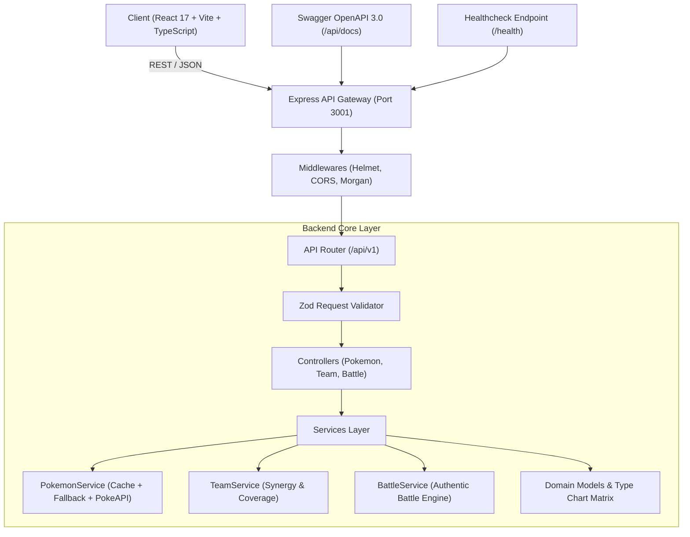

# ⚡ Pokémon Master - Fullstack Enterprise Architecture

Uma aplicação Fullstack moderna, robusta e profissional para gerenciamento de Pokémon, montagem estratégica de times e simulador de batalhas com mecânicas autênticas.

---

## 🏗️ Arquitetura do Sistema

O projeto segue os princípios de **Clean Architecture**, **Domain-Driven Design (DDD)** e **Separation of Concerns**, garantindo manutenibilidade, testabilidade e escalabilidade.



---

## 🌟 Funcionalidades Principais

### 🚀 Backend (`/server`)
- **TypeScript Strict Mode**: Tipagem estática fim a fim com ES2022.
- **Express + Clean Layered Architecture**:
  - `controllers/`: Gerenciamento de ciclo de vida HTTP.
  - `services/`: Regras de negócio desacopladas (cálculos de fraquezas, sinergia de times e simulação de batalha).
  - `schemas/`: Validação em tempo de execução com **Zod**.
  - `middlewares/`: Tratamento centralizado de erros RFC-compliant e validação estrita de requisições.
- **Documentação Interativa Swagger / OpenAPI 3.0**: Acessível em `http://localhost:3001/api/docs`.
- **Cache em Memória & Resiliência Offline**: Dados pré-carregados dos 151 Pokémon com fallback transparente e integração com a PokeAPI externa para IDs e nomes adicionais.
- **Simulador de Batalhas Autêntico**:
  - Fórmula oficial de dano escalonado.
  - Multiplicadores de eficácia elementar (Super Efetivo 2x/4x, Pouco Efetivo 0.5x/0.25x, Imune 0x).
  - Cálculo de acertos críticos (10% chance com 1.5x de dano).
  - Logs detalhados turno a turno.
- **Análise Estratégica de Times**:
  - Validação de limite de 1 a 6 integrantes.
  - Cálculo automático de cobertura de tipos e matriz de fraquezas.
- **Monitoramento**: Endpoint `/health` fornecendo status operacional, uptime e consumo de memória.
- **Testes Automatizados**: Suíte completa com **Vitest** e **Supertest**.

### 💻 Frontend (`/src`)
- **Pokédex Explorer**:
  - Busca instantânea por nome ou número.
  - Filtro interativo por qualquer um dos 18 tipos Pokémon.
  - Ordenação por Número, Nome, Total de Atributos (BST), Ataque, Defesa, Velocidade e HP.
  - Paginação rápida e responsiva.
- **Modal de Detalhes do Pokémon**:
  - Artwork oficial em alta resolução e sprite animado.
  - Barras animadas de atributos base.
  - Análise defensiva detalhada de fraquezas e resistências.
- **Team Builder Interativo**:
  - Bancada visual de 6 slots com apelidos personalizáveis.
  - Cobertura de tipos em tempo real.
  - Persistência e listagem de times salvos no backend.
- **Battle Arena**:
  - Seleção de combatentes e simulação em tempo real com barra de status e registro de eventos de combate.
- **Indicador de Saúde em Tempo Real**:
  - Badge no cabeçalho exibindo status e tempo de atividade do backend.

---

## 📡 Endpoints da API

| Método | Rota | Descrição |
|---|---|---|
| `GET` | `/health` | Status de saúde do serviço e tempo de atividade |
| `GET` | `/api/docs` | Documentação interativa Swagger UI |
| `GET` | `/api/v1/pokemon` | Lista paginada com filtros (`page`, `limit`, `search`, `type`, `sortBy`, `order`) |
| `GET` | `/api/v1/pokemon/:identifier` | Detalhes do Pokémon por ID ou nome |
| `GET` | `/api/v1/pokemon/:identifier/matchup` | Fraquezas, resistências e imunidades elementares |
| `GET` | `/api/v1/pokemon/types` | Lista de todos os 18 tipos elementares |
| `GET` | `/api/v1/pokemon/random` | Retorna Pokémon aleatórios para encontros |
| `GET` | `/api/v1/teams` | Lista todos os times cadastrados |
| `POST` | `/api/v1/teams` | Cria um novo time (1 a 6 Pokémon) com validação Zod |
| `GET` | `/api/v1/teams/:id` | Retorna detalhes de um time específico |
| `DELETE` | `/api/v1/teams/:id` | Remove um time pelo ID |
| `POST` | `/api/v1/battle/simulate` | Simula batalha entre 2 combatentes com relatório de turnos |

---

## 🛠️ Como Executar

## 🌐 Publicar na internet

O projeto está preparado para publicação na **Vercel**: o frontend é compilado como site estático e a API Express é servida por uma função em `/api`. A Vercel fornece um endereço público gratuito no formato `seu-projeto.vercel.app`; para usar um domínio próprio (por exemplo, `meusite.com.br`), é preciso registrar/comprar esse domínio e conectá-lo nas configurações do projeto.

### Passo a passo

1. Envie este projeto para um repositório GitHub (público ou privado).
2. Entre em [vercel.com](https://vercel.com), crie uma conta e escolha **Add New → Project**.
3. Importe o repositório. Mantenha a pasta raiz como diretório do projeto; a configuração de build e o `vercel.json` já estão neste nível.
4. Clique em **Deploy**. Quando terminar, abra o endereço `*.vercel.app` exibido pela Vercel. A interface e os endpoints `/api/v1/...`, `/api/docs` e `/health` usam o mesmo domínio.
5. Para domínio próprio, abra **Project → Settings → Domains**, informe o domínio e siga os registros DNS que a Vercel mostrar no painel do registrador do domínio. A Vercel configura HTTPS depois da validação do DNS.

Não há variáveis de ambiente obrigatórias para a publicação atual. A aplicação usa dados locais dos 151 Pokémon e consulta a PokeAPI como complemento.

**Atenção aos times salvos:** atualmente eles ficam em memória no processo da API. Em hospedagem serverless, como a Vercel, times criados podem desaparecer entre execuções. A Pokédex e as batalhas funcionam sem banco; para manter times permanentemente, será necessário conectar um banco de dados persistente antes de divulgar esse recurso como armazenamento confiável.

### 1. Iniciar Fullstack (Backend + Frontend simultaneamente)
```bash
npm run dev
```
- **Frontend**: `http://localhost:3000`
- **Backend API**: `http://localhost:3001`
- **Swagger Docs**: `http://localhost:3001/api/docs`

### 2. Iniciar Apenas o Backend
```bash
npm run dev:server
```

### 3. Iniciar Apenas o Frontend
```bash
npm run dev:client
```

### 4. Executar os Testes Automatizados
```bash
npm test
```

### 5. Compilar para Produção (Typecheck + Bundles)
```bash
npm run build
```
